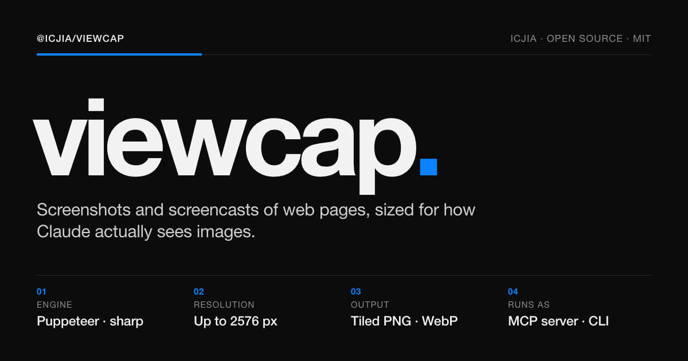

# @icjia/viewcap

[](https://www.npmjs.com/package/@icjia/viewcap)
[](LICENSE)


A lightweight local MCP server that does one thing well: takes screenshots of web pages optimized for Claude Vision.

**New in 0.3: sized for current Claude models.** Claude 4.7 and later (Opus 4.7 through 5.5, Sonnet 5 and 5.5, Haiku 5.5, Fable 5.x) read images at up to 2576 px and 4784 visual tokens, more than double the old limit viewcap was built around. viewcap now captures real desktop widths (default 1280×800, up to 2576) and sizes every image to what the model reads at full resolution. See [Image sizing for Claude](#image-sizing-for-claude).

## Why?

Chrome MCP's built-in screenshot functionality is unreliable — it frequently times out, returns blank images, or fails silently during capture. If you've tried asking Claude Code to "take a screenshot of localhost:3000" through Chrome MCP, you know the frustration.

ViewCap replaces Chrome MCP's screenshot capability with a purpose-built, reliable alternative. Chrome MCP continues to handle all other browser automation (DOM manipulation, navigation, clicking, etc.). ViewCap handles screenshots only.

## What it does

- Captures full-page screenshots, tiled so each image fits what Claude reads at full resolution (up to 2576 px / 4784 visual tokens on Claude 4.7+)
- Captures specific DOM elements by CSS selector
- Captures multi-frame screencasts with animated WebP export
- Returns base64 PNG images directly into your Claude conversation
- Optionally saves screenshots to disk as PNG files
- Standalone CLI for use outside of MCP clients
- Auto-restart with exponential backoff for crash resilience
- Runs as a local MCP server over stdio (no HTTP, no ports, no remote attack surface)

## Installation

### Prerequisites

- **Node.js >= 18** (check with `node --version`)
- **Claude Code**, **Cursor**, or any MCP-compatible client

### Option 1: npx (recommended, no install needed)

npx downloads and runs the package automatically. Nothing to install globally.

```bash
# Test that it works
npx -y @icjia/viewcap --help
```

### Option 2: Global install

```bash
npm install -g @icjia/viewcap
```

### Option 3: Clone for development

```bash
git clone https://github.com/ICJIA/viewcap-mcp.git
cd viewcap-mcp
npm install
```

## Setup with Claude Code

Claude Code manages MCP server lifecycle automatically — you register the server once, and Claude Code starts/stops it with each session.

### Using npx (recommended)

```bash
# Register for all projects (user-level)
claude mcp add viewcap -s user -- npx -y @icjia/viewcap

# Or register for current project only
claude mcp add viewcap -s project -- npx -y @icjia/viewcap
```

### Using a local clone

```bash
# Point directly at the source (for development)
claude mcp add viewcap -s user -- node /absolute/path/to/viewcap-mcp/src/server.js
```

### With JavaScript injection enabled

```bash
claude mcp add viewcap -s user -- npx -y @icjia/viewcap --allow-js
```

### Manual config (edit settings.json directly)

If you prefer, edit `~/.claude/settings.json`:

```json
{
  "mcpServers": {
    "viewcap": {
      "command": "npx",
      "args": ["-y", "@icjia/viewcap"]
    }
  }
}
```

### Verify it's registered

Restart Claude Code after registering. You should see viewcap listed when you run `/mcp` in Claude Code. Then test:

> "Use viewcap to take a screenshot of http://localhost:3000"

### Tool routing with Chrome MCP

If you have both Chrome MCP and viewcap registered, add this to your project's `CLAUDE.md` to ensure Claude uses the right tool:

```markdown
# Tool preferences
- For all screenshots, use the `viewcap` MCP server (take_screenshot, capture_selector, take_screencast, get_status).
- Use Chrome MCP for browser automation, DOM interaction, and navigation only.
```

## Setup with Cursor

Cursor supports MCP servers through its settings. Add viewcap to your Cursor MCP configuration:

### Global configuration

Edit `~/.cursor/mcp.json` (create it if it doesn't exist):

```json
{
  "mcpServers": {
    "viewcap": {
      "command": "npx",
      "args": ["-y", "@icjia/viewcap"]
    }
  }
}
```

### Project-level configuration

Create `.cursor/mcp.json` in your project root:

```json
{
  "mcpServers": {
    "viewcap": {
      "command": "npx",
      "args": ["-y", "@icjia/viewcap"]
    }
  }
}
```

After adding the configuration, restart Cursor. ViewCap's tools will be available to the AI assistant.

## Setup with other MCP clients

ViewCap works with any MCP client that supports stdio transport. The server communicates over stdin/stdout using JSON-RPC (the MCP protocol). Configure your client to spawn:

```bash
npx -y @icjia/viewcap
```

No HTTP ports, no environment variables, no API keys required.

## MCP Tools

### `take_screenshot`

Captures a full-page or viewport screenshot with automatic tiling.

| Parameter | Type | Default | Description |
|-----------|------|---------|-------------|
| `url` | string | *(required)* | HTTP or HTTPS URL to screenshot |
| `width` | number | 1280 | Viewport width in pixels (max 2576) |
| `height` | number | 800 | Viewport height in pixels (max 2576) |
| `fullPage` | boolean | true | Capture full scrollable page with automatic tiling |
| `waitUntil` | string | `domcontentloaded` | Page load event: `load`, `domcontentloaded`, `networkidle0`, `networkidle2` |
| `waitFor` | number | 0 | Additional delay in ms after page load (max 30000) |
| `javascript` | string | — | JS to evaluate before capture (requires `--allow-js` flag) |
| `directory` | string | — | Save PNGs to this directory; returns file paths instead of base64 |

**Returns:** Array of base64 PNG image content blocks (one per tile), or file paths if `directory` is set.

**Tiling:** Full-page screenshots too tall for one image are split into tiles with 50px overlap for context continuity. Each tile is as tall as the vision tier allows for the page's width (2576 px at 1280 wide on the high tier), so a typical page needs half as many tiles as before. Maximum 8 tiles per screenshot. See [Image sizing for Claude](#image-sizing-for-claude).

### `capture_selector`

Captures a screenshot of a specific DOM element by CSS selector.

| Parameter | Type | Default | Description |
|-----------|------|---------|-------------|
| `url` | string | *(required)* | HTTP or HTTPS URL to load |
| `selector` | string | *(required)* | CSS selector for the target element |
| `width` | number | 1280 | Viewport width in pixels (max 2576) |
| `height` | number | 800 | Viewport height in pixels (max 2576) |
| `waitUntil` | string | `domcontentloaded` | Page load event |
| `waitFor` | number | 0 | Additional delay in ms after page load (max 30000) |
| `selectorTimeout` | number | 5000 | Max ms to wait for selector to appear (max 15000) |
| `directory` | string | — | Save PNG to this directory; returns file path instead of base64 |

**Returns:** Single base64 PNG image content block (resized, if needed, to fit the vision tier), or file path if `directory` is set.

### `take_screencast`

Captures multiple frames of a web page over time. Captures the top 1280x800 viewport per frame.

| Parameter | Type | Default | Description |
|-----------|------|---------|-------------|
| `url` | string | *(required)* | HTTP or HTTPS URL to capture |
| `duration` | number | 10 | Total capture time in seconds (max 60) |
| `interval` | number | 2 | Seconds between frames (min 0.5) |
| `waitUntil` | string | `domcontentloaded` | Page load event |
| `waitFor` | number | 0 | Pre-capture delay in ms (max 30000) |
| `javascript` | string | — | JS to execute before first frame (requires `--allow-js` flag) |
| `directory` | string | — | Save frames + animated WebP to this directory |

**Returns:** Array of base64 PNG image content blocks (one per frame), or file paths if `directory` is set. When saving to directory, also generates an animated WebP.

**Limits:** Maximum 20 frames per screencast, maximum 60 seconds duration.

### `get_status`

Returns viewcap server version (with an npm update check), installed Puppeteer and sharp versions, whether JavaScript injection is enabled, Node version, and platform. Takes no parameters.

```
viewcap status
  Server:       @icjia/viewcap v0.2.0 (latest)
  Puppeteer:    v24.40.0
  sharp:        v0.34.5
  JS injection: disabled (launch with --allow-js to enable)
  Node:         v22.22.2
  Platform:     darwin arm64
```

## Image sizing for Claude

Claude reads images in 28×28-pixel patches, called visual tokens: an image costs `⌈width/28⌉ × ⌈height/28⌉` tokens. Each model generation has a maximum long edge and a maximum token count. Anything larger is scaled down by the API before the model sees it, which blurs small text and wastes the pixels you sent.

| Vision tier | Models | Max long edge | Max visual tokens |
|---|---|---|---|
| `high` (default) | Claude 4.7 and later: Opus 4.7, 4.8, 5, 5.5 · Sonnet 5, 5.5 · Haiku 5.5 · Fable / Mythos 5.x | 2576 px | 4784 |
| `standard` | Older models: Opus 4.6, Sonnet 4.6, Haiku 4.5 and earlier | 1568 px | 1568 |

viewcap sizes every image it returns to fit the active tier exactly, so nothing gets scaled again on the way in:

- **Viewport screenshots** pass through at full size when they fit. A 1920×1080 capture is 2,691 tokens on the high tier, unchanged.
- **Full pages** are tiled, and each tile is as tall as the tier allows for that width. At 1280 px wide on the high tier, that's a 2576 px tile (4,232 tokens), so a typical page needs half as many images as with the old 1072 px tiles.
- **Elements and screencast frames** are scaled down only if they exceed the tier.

Pick the tier for the model you use:

```bash
claude mcp add viewcap -s user -- npx -y @icjia/viewcap --vision-tier=standard   # MCP server arg
VIEWCAP_VISION_TIER=standard viewcap capture https://example.com                # env var (MCP or CLI)
viewcap --vision-tier standard capture https://example.com                      # CLI flag
```

`get_status` (and `viewcap --help`) shows the active tier.

**Before 0.3**, viewcap capped viewports and images at 1072 px, tuned for the standard tier's ~1.15-megapixel sweet spot. That made 1280, 1440 and 1920 px desktop breakpoints impossible to capture at their real width.

**Token cost** scales with pixel area, not content. Higher-resolution images cost more per image, but a tier-sized tile covers more of the page, so a full page costs about the same in total while text stays sharp. If you need to save tokens, capture a smaller viewport (`width`/`height`) or a single element (`capture_selector`).

**Many images in one conversation:** when a single API request contains more than 20 images, the API applies a stricter per-image size limit to all of them, and screenshots from earlier turns count. viewcap keeps tile counts low (at most 8 per capture), but in a long session with many full-page captures, prefer viewport or element shots.

## MCP or CLI?

The other ICJIA tools (axecap, lightcap and contrastcap) now work well as plain CLIs, because their output is text. viewcap is different: its output is **images**, and only an MCP tool can hand an image straight to the model. A shell command can only return text, so Claude would have to save a PNG and then open it, two steps instead of one, for the same image tokens. **For Claude, keep viewcap as an MCP server.**

The `viewcap` CLI is still useful wherever images go to files instead of to a model: saving screenshots for a report or a pull request, CI visual checks, or scripts. See [CLI (standalone usage)](#cli-standalone-usage).

## Usage examples

From Claude Code or Cursor, just ask naturally:

```
"Take a screenshot of localhost:3000"
"Screenshot https://example.com with networkidle0"
"Capture the #header element on localhost:3000"
"Take a screenshot of localhost:3000 and save it to ./screenshots"
"Screenshot localhost:3000 with fullPage set to false"
"Record 5 frames of localhost:3000 every 2 seconds"
"Take a screencast of localhost:3000 for 10 seconds and save to ./recordings"
```

## CLI (standalone usage)

ViewCap includes a standalone CLI for use outside of MCP clients:

```bash
# Install globally (or use npx)
npm install -g @icjia/viewcap

# Full-page screenshot
viewcap capture https://example.com -o screenshot.png

# Viewport only (no full-page scroll)
viewcap capture https://example.com --no-full-page -o shot.png

# Real desktop breakpoints (default 1280x800, max 2576)
viewcap capture http://localhost:3000 -w 1920 -h 1080 --no-full-page -o desktop-1920.png

# Size images for an older (standard-tier) model
viewcap --vision-tier standard capture https://example.com -o shot.png

# Capture a specific element
viewcap selector https://example.com "#main-content" -o element.png

# Wait for SPA to render
viewcap capture http://localhost:3000 --wait-until networkidle0 --wait-for 2000 -o app.png

# Save tiles to a directory
viewcap capture https://example.com -d ./screenshots

# Screencast: capture frames over time
viewcap screencast http://localhost:3000 --duration 10 --interval 2 -d ./recordings

# With JS injection
viewcap --allow-js capture http://localhost:3000 --js "document.querySelector('.modal').remove()" -o clean.png

# Verbose logging
viewcap --verbose capture http://localhost:3000 -o debug.png

# Versions and help (plain `viewcap` at a terminal shows help too)
viewcap --version     # viewcap v0.3.0 (Puppeteer v24.x)
viewcap --help        # also shows the active vision tier
```

## Auto-restart

When running as an MCP server (the default mode), ViewCap includes an auto-restart wrapper that recovers from crashes:

- Exponential backoff: 1s, 2s, 4s, 8s... up to 30s
- Maximum 10 restart attempts within a 1-minute window
- Graceful shutdown on SIGINT/SIGTERM
- All restarts logged to stderr

To bypass the restart wrapper (useful for debugging):

```bash
node src/restart.js --no-restart
```

## Testing

```bash
# Run all tests
npm test

# Run a specific test file
node --test test/url-validation.test.js

# Run the integration suite (launches real Chromium against a local HTTP server)
npm run test:integration
```

The unit suite (106 tests) covers:
- **URL validation** — scheme whitelist, hostname blocklist, metadata endpoint blocking
- **Directory validation** — path traversal prevention, symlink escape detection
- **Tiling logic** — tile positions, overlap, max-tile cap, edge cases
- **Config constants** — sanity checks on all configuration values
- **JS injection gate** — disabled by default, enabled with `--allow-js`
- **IP blocking** — localhost bypass, external hostname resolution, RFC1918 prefix coverage (all 172.16-31.x, 10.x, 192.168.x, fe80:, fd00:), public IP boundary checks
- **CLI input validation** — clampInt/clampFloat with NaN, Infinity, out-of-range, OOM-level dimensions, boundary cases
- **Symlink escape** — /tmp→/etc symlink attack, realpath verification on macOS
- **Screencast limits** — frame count, duration caps
- **Logging** — verbosity levels
- **CLI/server routing** — subcommand detection with leading global flags, `--help`/`--version` handling
- **Version** — single source of truth in package.json

The integration suite (7 tests) drives real Chromium against a local HTTP server: operations longer than the idle timeout, idle re-arm after operations, animated WebP page count and frame delay, tile filename grouping, and `restart.js` bin routing (`--help`, `--version`, global flags before a subcommand).

## Local development

There is no build step. ViewCap is plain JavaScript with ES modules. The source files are what ships to npm.

```
Edit source files
      |
      v
Restart Claude Code (re-spawns the server from source)
      |
      v
Test by talking to Claude Code ("screenshot localhost:3000")
      |
      v
See a bug? Edit the file, restart Claude Code, repeat.
```

### Quick development setup

```bash
# 1. Clone and install
git clone https://github.com/ICJIA/viewcap-mcp.git
cd viewcap-mcp
npm install

# 2. Register your local copy with Claude Code
claude mcp add viewcap -s user -- node $(pwd)/src/server.js

# 3. Restart Claude Code

# 4. Spin up a test target in another terminal
npx serve -l 3000 .

# 5. Test from Claude Code:
#    "Use viewcap to screenshot http://localhost:3000"
```

After editing source files, restart Claude Code to pick up changes (the server is re-spawned fresh each startup).

## Architecture

```
src/
├── server.js ........... MCP server init + tool handlers
├── browser.js .......... Singleton Puppeteer lifecycle + idle cleanup
├── capture.js .......... Screenshot, resize, tile, selector capture
├── screencast.js ....... Multi-frame capture + animated WebP
├── restart.js .......... Auto-restart wrapper with exponential backoff
├── cli.js .............. Commander-based standalone CLI
├── routing.js .......... CLI vs MCP-server invocation detection
└── config.js ........... Constants + version + logging helper
```

Six dependencies: `@modelcontextprotocol/server`, `zod`, `puppeteer`, `sharp`, `commander`, `@cfworker/json-schema`.

## Security

ViewCap runs locally over stdio — no network listener, no ports, no remote attack surface. Security mitigations focus on preventing misuse through prompt injection.

An adversarial red/blue team audit was conducted after the initial release. All critical and high findings were fixed in v0.1.1. See [CHANGELOG.md](CHANGELOG.md) for the full list.

### SSRF prevention

- **Scheme whitelist:** Only `http:` and `https:` URLs are allowed. `file://`, `data:`, `javascript:`, and all other schemes are blocked.
- **Metadata endpoint blocklist:** AWS (`169.254.169.254`), GCP (`metadata.google.internal`), and Azure (`metadata.azure.com`) metadata endpoints are blocked.
- **Private IP range blocklist:** All RFC1918 private ranges (`10.x`, `172.16-31.x`, `192.168.x`), IPv4 link-local (`169.254.x`), and IPv6 link-local/unique-local (`fe80:`, `fd00:`) are blocked. This prevents reaching internal network services via alternate IP encodings.
- **IP resolution:** Hostnames are resolved to IP addresses and checked against blocked ranges, catching hex IPs, octal IPs, IPv6-mapped addresses, and DNS wildcard services.
- **Fail-closed DNS:** If hostname resolution fails, the request is blocked (not allowed). This prevents DNS poisoning or resolution failures from bypassing IP checks.
- **Post-navigation recheck:** After page load, the final URL is re-validated to catch HTTP redirects and DNS rebinding attacks.

### JavaScript injection

- **Disabled by default.** The `javascript` parameter is rejected unless the server is launched with `--allow-js`.
- When enabled, every script execution is logged to stderr with a SHA-256 hash for audit traceability.

### Directory traversal prevention

- Output paths are validated against the user's home directory and `/tmp` only.
- The deepest existing ancestor directory is resolved via `realpathSync` **before** any new directories are created, preventing TOCTOU symlink swap attacks.
- After creation, the final path is re-verified against allowed roots (belt and suspenders).

### Error message safety

- Error messages returned to the AI are generic (e.g., "Blocked URL scheme") and never include internal paths, IPs, or stack traces.
- External URL logging writes hostname only (not full URL) to stderr, preventing token leakage from query parameters.

### Input validation

- **MCP path:** All parameters validated by Zod schemas with enforced min/max bounds. `waitFor` capped at 30s, `selectorTimeout` at 15s, viewport dimensions at 2576px.
- **CLI path:** All numeric inputs validated with bounds checking (`clampInt`/`clampFloat`), preventing OOM from oversized dimensions or indefinite hangs from uncapped timeouts.
- **Request serialization:** A single shared async queue serializes all capture operations (screenshots, selectors, and screencasts) to prevent concurrent Puppeteer page collisions.

### Resource limits

| Resource | Limit | Enforced By |
|----------|-------|-------------|
| Screenshot tiles | 8 max | capture.js |
| Screencast frames | 20 max | screencast.js |
| Screencast duration | 60s max | Zod schema + screencast.js |
| Page navigation timeout | 30s | browser.js |
| `waitFor` delay | 30s max | Zod schema + capture.js |
| Selector wait timeout | 15s max | Zod schema + capture.js |
| Selector string length | 1000 chars max | capture.js |
| Viewport dimensions | 2576px max | Zod schema + CLI clamp |
| Browser idle shutdown | 60s | browser.js |

### Known limitations

These were identified in the security audit and are accepted trade-offs:

- **DNS rebinding (partial mitigation):** Post-navigation URL recheck catches most rebinding attacks, but a sufficiently fast rebind between `page.goto()` start and `page.url()` check could theoretically succeed. Full mitigation would require Puppeteer-level DNS pinning, which is not available.
- **`--allow-js` exfiltration:** When JS injection is enabled, injected scripts can make arbitrary network requests from the page context. Chromium does not enforce CORS in `page.evaluate()`. This is an accepted trade-off of the `--allow-js` flag.
- **MCP SDK alpha:** The `@modelcontextprotocol/server` package is currently at v2.0.0-alpha. Will track for stable release.

## Configuration flags

| Flag | Description |
|------|-------------|
| `--allow-js` | Enable JavaScript injection via the `javascript` parameter |
| `--verbose` | Log navigation events, tile counts, timing, browser lifecycle |
| `--quiet` | Log errors only |
| `--no-restart` | Bypass auto-restart wrapper (run server directly) |

## Browser lifecycle

ViewCap manages a singleton Puppeteer/Chromium instance:

1. **First screenshot request** launches Chromium (headless)
2. **Each request** opens a new page, navigates, captures, closes the page
3. **60 seconds of inactivity** automatically shuts down Chromium
4. **Next request** relaunches Chromium transparently
5. **On Claude Code exit** the server and Chromium are killed automatically

First launch downloads Chromium (~170MB, cached for subsequent runs).

## Clean-room notice

This project's design is informed by the feature set and API patterns of [`@just-every/mcp-screenshot-website-fast`](https://www.npmjs.com/package/@just-every/mcp-screenshot-website-fast). **This is a clean-room implementation. No code from the reference package is used. All implementation is original.**

## License

MIT. See [LICENSE](LICENSE).
